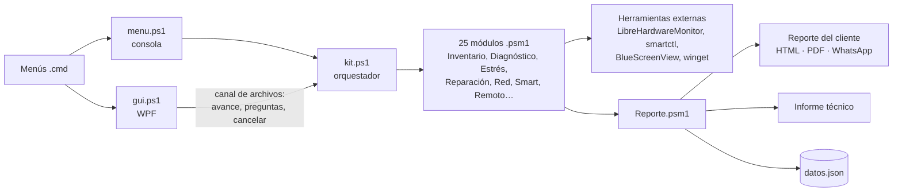
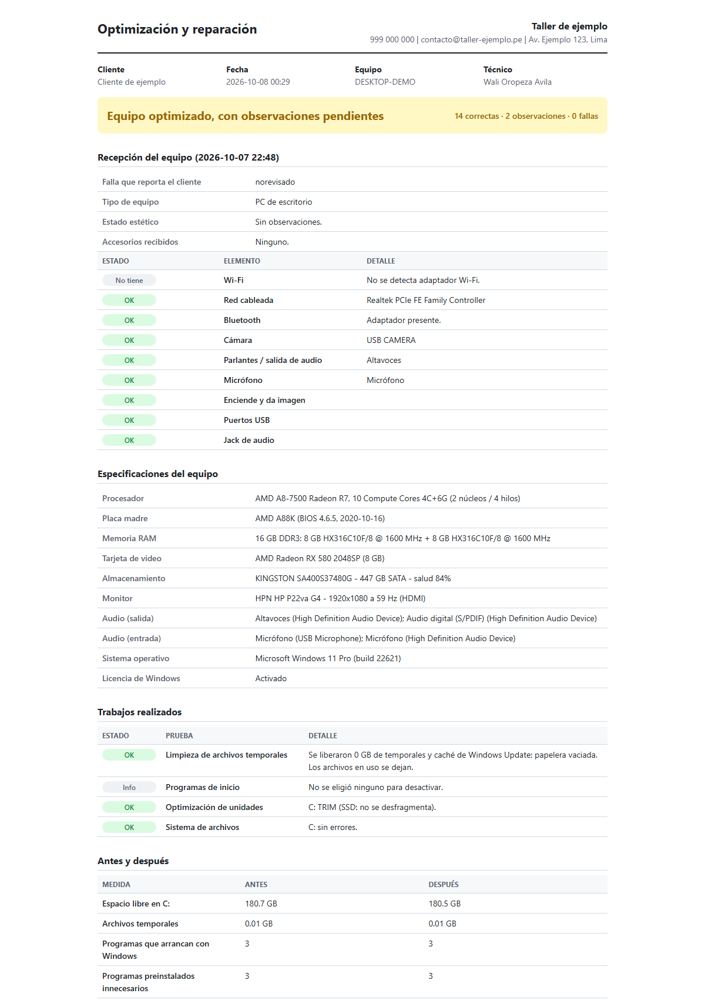
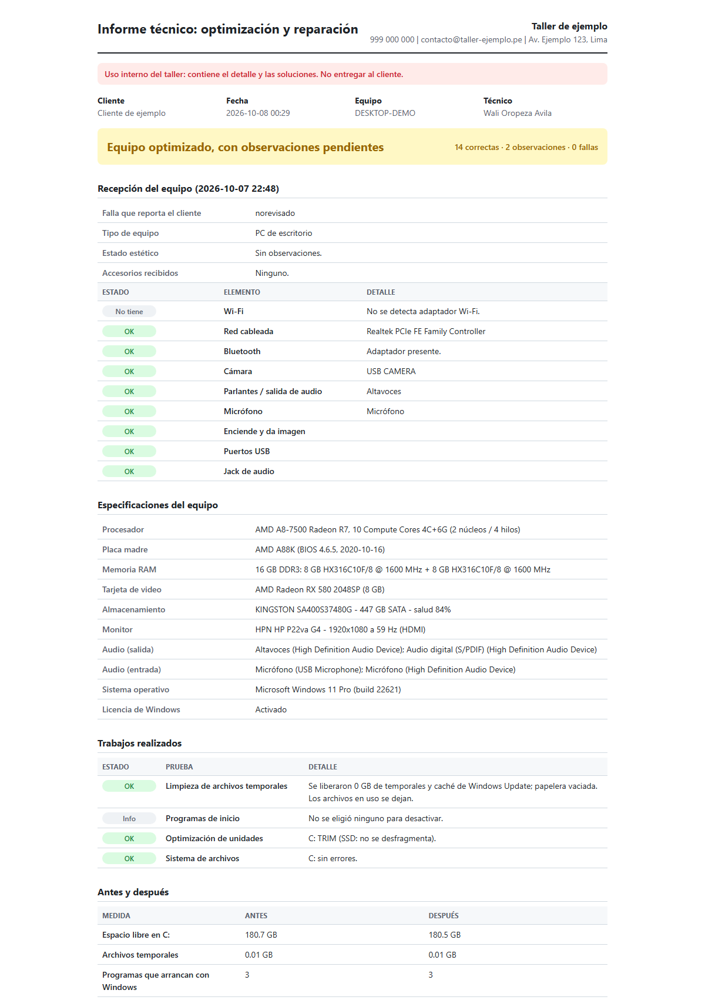

# PulsoPC

Diagnóstico, preparación y pruebas de estrés para PCs recién ensambladas, con reporte para el cliente. Corre desde una USB con el PowerShell 5.1 que trae Windows 10/11: no hay que instalar nada en el equipo.

  

> 🔒 **Código privado.** Este repositorio muestra el proyecto; el código está disponible a pedido en oropeza.dev@gmail.com.

## Lo más destacado

- **Sin instalar nada:** corre desde una USB con lo que ya trae Windows (PowerShell 5.1 y .NET), incluso en equipos recién formateados o sin internet.
- **Tres servicios de taller:** puesta a punto de PCs nuevas, diagnóstico con ficha de recepción y reparación con mediciones antes y después.
- **Diagnóstico profundo:** salud SMART de discos, temperaturas y ventiladores, pantallazos azules explicados, caídas del driver de video, red capa por capa, impresoras, Windows Update, amenazas y programas que se cierran.
- **Pruebas de estrés** de CPU, RAM, disco y GPU (WebGL propio), con un registro de seguridad que se guarda aunque el equipo se reinicie.
- **Atención remota segura:** paquete cifrado con AES-256, código de un solo uso, vencimiento y autolimpieza.
- **Dos reportes por servicio:** uno para el cliente, claro y sin jerga (HTML, PDF y resumen para WhatsApp), y un informe técnico completo para el taller.
- **Interfaz gráfica WPF** con avance visible y cancelación, además de los menús de consola, y **modo simulación** para probar sin tocar el equipo.

## Arquitectura

La lógica vive en módulos independientes con pruebas Pester; `kit.ps1` arma cada servicio combinándolos, y la interfaz gráfica lo ejecuta en segundo plano comunicándose por archivos, de modo que una prueba larga nunca congela la ventana.

## Capturas

Reporte real de un servicio de reparación, con los datos del cliente reemplazados.

**Reporte para el cliente**

**Informe técnico para el taller**

## Requisitos del equipo

- Windows 10 versión 1803 o posterior, o Windows 11 (PowerShell 5.1 y .NET Framework 4.7.2 vienen incluidos).
- Edge o Chrome para la prueba de GPU (WebGL 2).

## Contacto

📬 oropeza.dev@gmail.com · [LinkedIn](https://www.linkedin.com/in/jhonatan-oropeza) · [Perfil de GitHub](https://github.com/oropezadev-wq)
